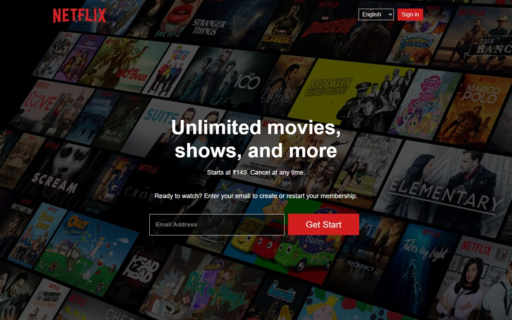

# Netflix Landing Page

[](https://akarshkv1234-glitch.github.io/Netflix/)
[](https://developer.mozilla.org/docs/Web/HTML)
[](https://developer.mozilla.org/docs/Web/CSS)



A responsive recreation of the Netflix landing page, built with plain HTML and CSS.

**Live demo:** https://akarshkv1234-glitch.github.io/Netflix/

## Features

- Hero section with email sign-up call to action
- Feature sections
- FAQ section
- Footer
- Responsive layout

## Built with

- HTML5
- CSS3

## Run locally

Open `index.html` in a browser, or serve the folder:

```bash
python -m http.server 8000
```

## Note

This is an educational front-end clone. It is not affiliated with or endorsed
by Netflix. All trademarks belong to their respective owners.
